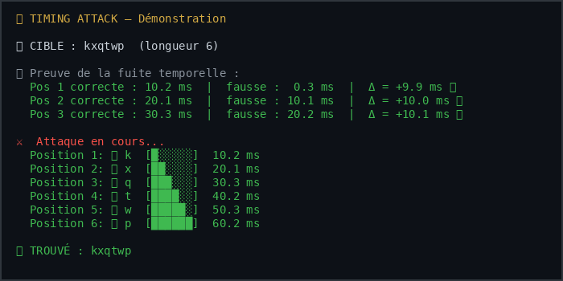

# 🕐 Timing Attack: Guess a Password with a Stopwatch

<p align="center">
  <a href="README.md">English</a> &bull;
  <a href="README_fr.md">Français</a>
</p>

**Demonstration of a side-channel attack.**

## The vault analogy

Imagine a combination safe. Normally, for a 4-digit code, you have to try up to 10,000 combinations.

But imagine this safe has a flaw: every time you turn the **right** digit, the mechanism makes a "click" that is just a tiny bit longer. Imperceptible to the ear, but measurable with a good microphone.

Result: instead of 10,000 attempts, you need only **40** (10 per digit). You have just cracked the safe with a stopwatch.

## How it works

Many password comparison functions look like this:

```python
def check_password(guess, real):
    for i in range(len(real)):
        if guess[i] != real[i]:
            return False  # ← Immediate return
    return True
```

Problem: the higher the number of correct characters, the longer the function takes to respond. That difference (a few microseconds) is enough to guess the password **character by character**.

```
Password: "secret"

Attempt "s00000" → compare 's'='s' ✓, '0'='e' ✗ → 2 comparisons → ~2 µs
Attempt "a00000" → compare 'a'='s' ✗ → 1 comparison    → ~1 µs
                                         ↑
                              "s" is longer → that is the right one!
```

## Demo



```bash
python3 timing-attack.py
```

```
🎯 TARGET: kxqtwp  (length 6)

  Position 1: ✅ k  [█░░░░░]  3.42 µs
  Position 2: ✅ x  [██░░░░]  3.51 µs
  Position 3: ✅ q  [███░░░]  3.63 µs
  Position 4: ✅ t  [████░░]  3.74 µs
  Position 5: ✅ w  [█████░]  3.85 µs
  Position 6: ✅ p  [██████]  3.96 µs

✅ FOUND: kxqtwp
```

## The limit of the timing channel (and the sentinel)

> **Pedagogical honesty note.** In the "classic" comparison
> (`for … if requète[…] != … return False`), the **last character** is
> ambiguous: a wrong candidate that diverges at the last byte runs *as many*
> comparisons as the right character. The times are identical → it is
> impossible, without cheating, to distinguish the right last letter *solely*
> through timing. Many demos cheat by reusing the secret to settle
> that last character (a hidden equality oracle): this version does not do
> that.

To make the demo complete **without reusing the secret in the attack**, the
simulated target `check_password()` materializes a **sentinel termination**:
a real server, when the password is entirely correct, performs
post-authentication processing (session, HMAC, database query…) that costs
time. That cost is simulated by an additional delay at the very end. The
sentinel means that a *complete match* is measurably longer than a
divergence at the last byte → **the leak of the last character becomes real
again and reproducible**, still without direct access to the secret from the
attack.

The attack *never* consults the secret: everything goes only through the
response time of the target, sentinel included.

## Why it matters

- This attack works on **API token comparisons**, **HMAC signatures**, **passwords**
- The standard countermeasure: `hmac.compare_digest()`, comparison in **constant time**
- In 2026, it remains one of the most underestimated vulnerabilities

## Usage

```bash
# Automatic demo
python3 timing-attack.py --demo

# Attack a specific password
python3 timing-attack.py "mon_mot_de_passe"
```

Exit code: `0` success (password recovered), `1` failure (character outside
the attacked charset), `2` misuse.

Environment variables:
```bash
export TIMING_SLEEP=0.01    # artificial delay per comparison (default 0.01 s)
export TIMING_CHARSET=abcdefghijklmnopqrstuvwxyz0123456789  # attacked charset
```

## Countermeasure

```python
# ❌ Vulnerable
if user_input == secret:
    ...

# ✅ Constant time
import hmac
if hmac.compare_digest(user_input, secret):
    ...
```

## License

MIT
